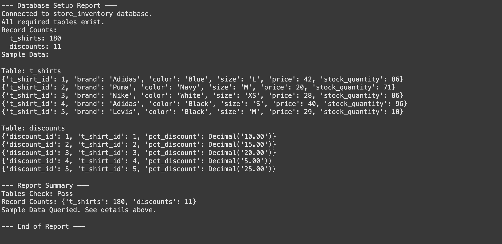
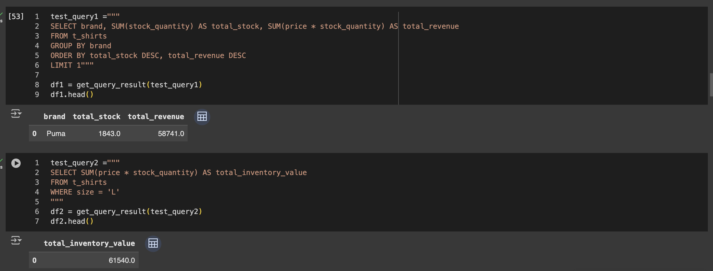
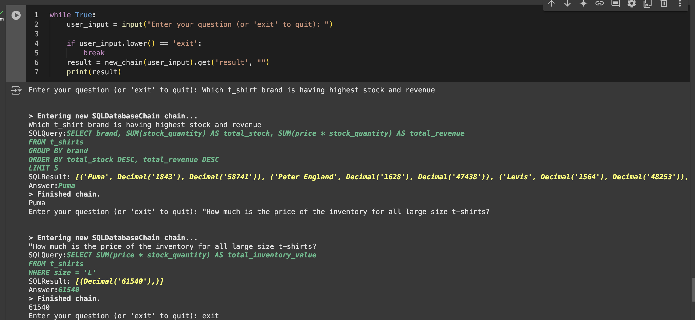
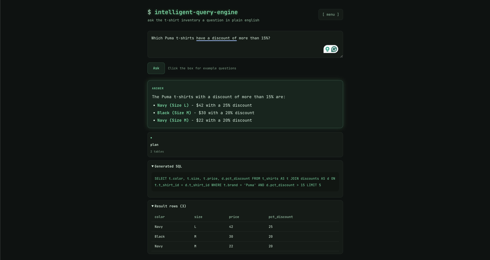
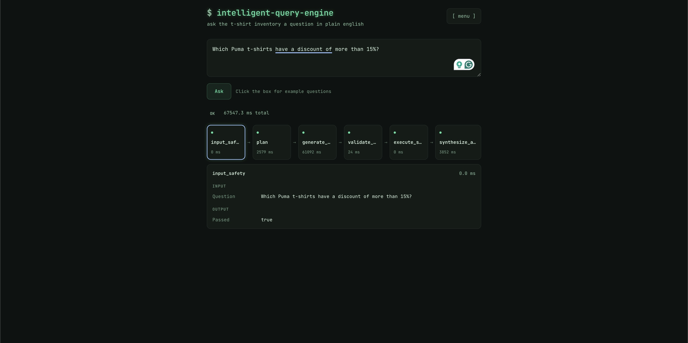
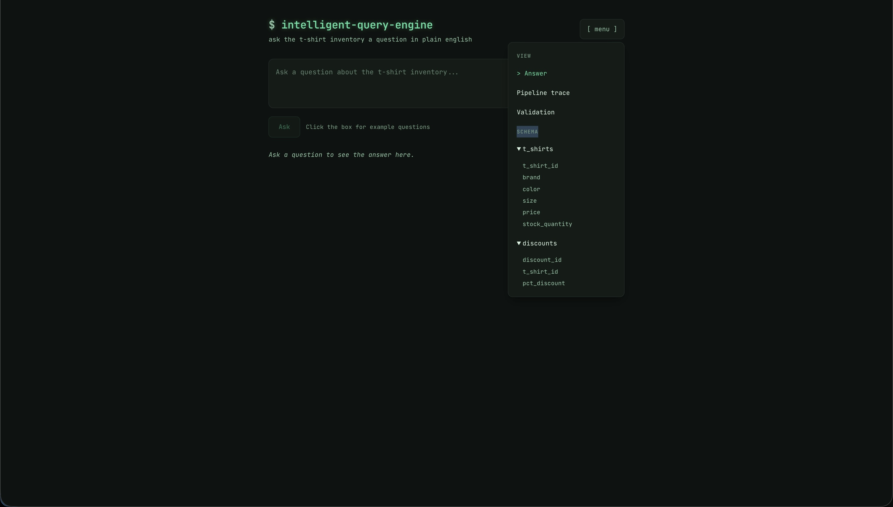
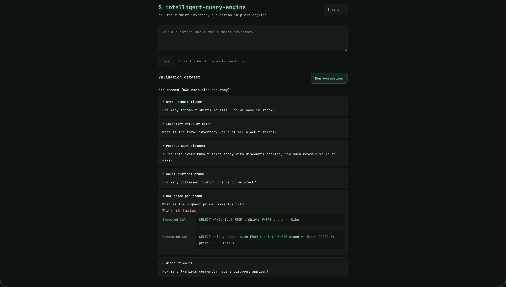

# 🧠❓ Intelligent Query Engine: A Modern AI-Powered Query System

This repository hosts the **Intelligent Query Engine**, an AI-driven query solution that integrates advanced natural language processing with robust database querying. The system leverages state-of-the-art AI models, vector databases, and traditional relational databases to provide seamless, intelligent interactions with your data.

## 🌱 Features

- **Google Gemini and Hugging Face Embeddings**: Harnesses the power of cutting-edge language models to understand natural language queries and convert them into precise SQL statements.
- **ChromaDB for Vector Storage**: Efficiently stores and retrieves embeddings for context-aware querying and semantic search.
- **MySQL Backend**: Queries structured data stored in a traditional relational database, ensuring compatibility with existing workflows.
- **LangChain Integration**: Chains complex logic and workflows, enabling multi-step querying and decision-making.
- **Notebook-Based Development**: Experimentation and prototyping in a flexible, interactive environment.
- **FastAPI Backend + React (TypeScript) Frontend**: A full app built on top of the notebook prototype, with an explicit `plan → generate SQL → validate → execute → answer` pipeline.
- **SQL Guardrails & Schema Verification**: Every generated query is checked against the live schema and restricted to safe, read-only, single-statement `SELECT`s before it's ever executed.
- **Built-in Observability**: Per-request pipeline traces (per-stage timings and inputs/outputs) are recorded and exposed via the API.
- **Validation Dataset**: A held-out set of question/SQL pairs scored for execution accuracy via `make eval`.

## 💡 Key Capabilities

1. **Natural Language to SQL**: Users can ask questions in plain English, and the engine generates accurate SQL queries to fetch results from MySQL.
2. **Semantic Search**: Find relevant information using vector-based similarity searches stored in ChromaDB.
3. **Dynamic Context Management**: Adapts to user queries with contextual understanding powered by Google Gemini and Hugging Face embeddings.
4. **Scalability**: Designed to handle large datasets and complex queries easily.
5. **Modular Design**: Extensible architecture for integrating additional AI models or database systems.

## ⚙️ System Flow Chart

This structure provides a high-level overview of how the various components interact in your Intelligent Query Engine project. 

**Intelligent Query Engine**:

```
                    +---------------------+
                    |    User Query       |
                    | (Natural Language)  |
                    +----------+----------+
                               |
                               v
                   +-------------------------+
                   | Google Gemini / Hugging |
                   | Face Embeddings (NLP)   |
                   +-----------+-------------+
                               |
                               v
               +------------------------------+
               |      LangChain (Workflow)    |
               +-----------+------------------+
                               |
           +-------------------+------------------+
           |                                      |
           v                                      v
  +------------------+                   +-------------------+
  |   ChromaDB       |                   |   MySQL Database  |
  | (Vector Storage) |                   |  (Structured Data)|
  +------------------+                   +-------------------+
           |                                      |
           +-------------------+------------------+
                               |
                               v
                   +--------------------------+
                   |  SQL Query Generation    |
                   |  (Data Fetching)         |
                   +--------------------------+
                               |
                               v
                   +--------------------------+
                   |    Final Results         |
                   |   (Returned to User)     |
                   +--------------------------+
```

### 🔄 Flow Explanation:
1. **User Query (Natural Language)**: The user inputs a query in natural language.
2. **Google Gemini / Hugging Face Embeddings**: These models process and embed the query into a format suitable for understanding and further processing.
3. **LangChain**: Orchestrates the multi-step process and integrates different components.
4. **ChromaDB**: Stores vector embeddings for context-based search, aiding in query understanding.
5. **MySQL Database**: The relational database where the actual data resides.
6. **SQL Query Generation**: Translates the processed natural language query into a precise SQL statement.
7. **Final Results**: The result of the query execution is returned to the user.

## ✅ Applications

- Business Intelligence: Ask complex questions about your data and receive actionable insights.
- E-commerce: Query inventory, pricing, and sales data in natural language.
- Research: Extract patterns and trends from structured datasets without SQL expertise.
- Data Analytics Teams: Bridge the gap between technical and non-technical users by democratizing access to data.

## 🏗️ Project Structure

The notebook prototype has grown into a full app, split into a backend and frontend:

```
.
├── backend/        # FastAPI service — pipeline, guardrails, tracing, eval (see backend/README.md)
├── frontend/        # React + TypeScript UI (see frontend/README.md)
├── experiment/      # Original notebooks used for prototyping (kept as reference)
├── images/          # Screenshots referenced below
└── Makefile         # One place to install, seed, run, and evaluate everything
```

## 🚜 Getting Started

This repository started as a notebook-based prototype (see `experiment/`) and has since grown
into a runnable app: a FastAPI backend (`backend/`) and a React + TypeScript frontend
(`frontend/`), tied together by the root `Makefile`. The app targets a local SQLite database
by default, so there's no MySQL server to stand up — the original MySQL-based notebooks are
kept as-is under `experiment/` for reference.

### ⚡ Quickstart (Makefile)

```bash
make install   # uv sync (backend) + npm install (frontend)
make seed      # create and seed the local SQLite inventory database
```

Add your Gemini API key to `backend/.env` (copy `backend/.env.example` if you haven't already —
get a key at https://aistudio.google.com/apikey), then:

```bash
make dev       # run backend (:8000) and frontend (:5173) together, Ctrl-C stops both
```

Other useful targets:

```bash
make backend         # run only the FastAPI backend, with reload
make frontend         # run only the Vite dev server
make eval             # score the NL->SQL pipeline against the validation dataset
make build-frontend   # type-check and build the frontend for production
make clean            # remove venvs, node_modules, build output, and local data
make help              # list all available targets
```

Open http://localhost:5173 once `make dev` is running — ask a question, and inspect the
generated SQL, the plan, and the full pipeline trace in the UI.

### 🛠 Components
1. **AI Model**: Google Gemini and Hugging Face embeddings (`sentence-transformers/all-MiniLM-L6-v2`) for query understanding.
2. **Vector Database**: ChromaDB for storing and retrieving embeddings.
3. **Relational Database**: MySQL for the original notebook prototype; SQLite for the `backend/` app.
4. **Orchestration**: LangChain for chaining steps like embedding retrieval, query generation, and data fetching.

### 🔬 Experiment Outcomes:

- ⛃ Snapshot of Database 



- 👨🏻‍💻 Output from the raw SQL query



- 🦾 Output from the AI (LLM) prompt query



##### Note: Utilized `T4 GPU` in Google Colab-Notebook to complete the experiment.

### 📸 Application Screenshots

- Answer view — a question, the generated SQL, the plan, and the result rows:



- Pipeline trace — every stage (`input_safety → plan → generate_sql → validate_sql → execute_sql → synthesize_answer`), with per-stage timing and detail on click:



- Menu — switch views or drill into the live DB schema, collapsed until clicked:



- Validation — the held-out question/SQL dataset scored for execution accuracy via `make eval`:


